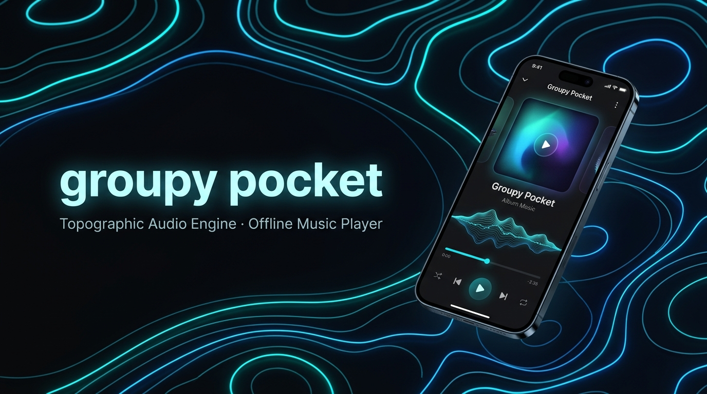
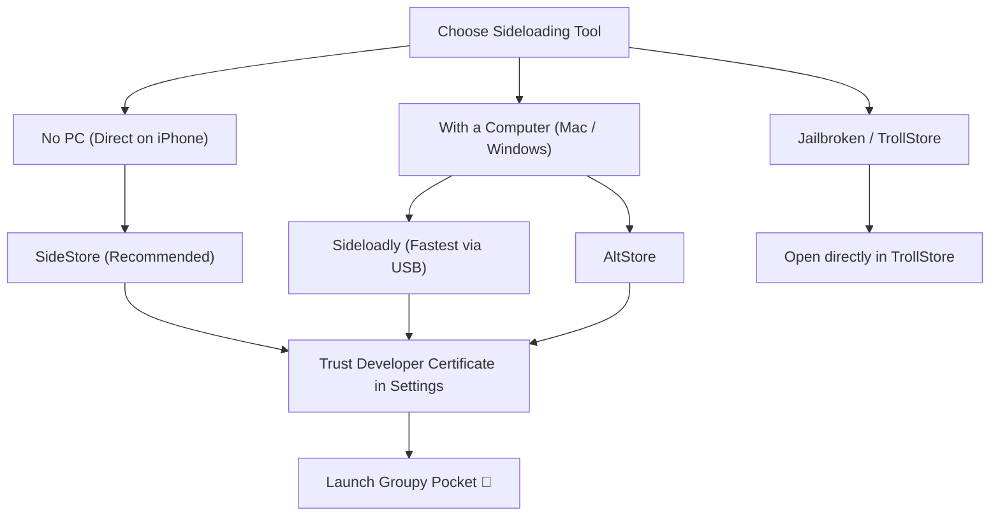
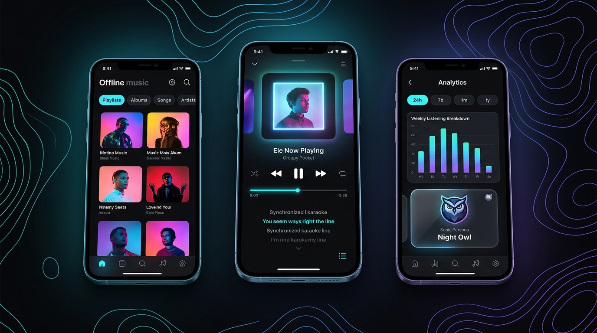

  

  
  
  
  
  
  

  <a href="#-quick-download"><b>⚡ Quick Download</b></a> ·
  <a href="#-android-installation-3-easy-steps"><b>🤖 Android Guide</b></a> ·
  <a href="#-ios-installation-guide"><b>🍎 iOS Guide</b></a> ·
  <a href="#-features--whats-new"><b>✨ Features</b></a> ·
  <a href="#-how-updates-work"><b>🔄 Updates</b></a> ·
  <a href="#-faq--troubleshooting"><b>❓ FAQ</b></a> ·
  <a href="https://groupy.iriskernel.dev"><b>🌐 Groupy Web</b></a>

---

### Welcome to Groupy Pocket

**Groupy Pocket** is the official free and offline-first mobile music player for the [Groupy](https://groupy.iriskernel.dev) streaming platform. Download your favorite tracks, full albums, and community playlists directly to your phone, and enjoy seamless offline listening with time-synced lyrics, lockscreen playback controls, fluid topographic shader themes, and bidirectional cloud telemetry sync.

> [!NOTE]
> **100% Free, Private, and Ad-Free**: Groupy Pocket has zero ads, zero tracking, and zero subscriptions. All downloaded music and library databases live directly inside your phone's sandbox storage.

---

## ⚡ Quick Download

Download the latest production release (**v0.0.1**) directly below:

| Platform | File Type | Direct Download Link | Compatibility |
| :--- | :---: | :--- | :--- |
| **Android** | `.apk` | [⬇️ **Download GroupyPocket.apk**](https://github.com/iriskernel/groupy-pocket-releases/releases/latest/download/GroupyPocket.apk) | Android 8.0 (Oreo) or newer · Direct install |
| **iOS / iPadOS** | `.ipa` | [⬇️ **Download GroupyPocket.ipa**](https://github.com/iriskernel/groupy-pocket-releases/releases/latest/download/GroupyPocket.ipa) | iOS 15.0 or newer · Sideload via SideStore / AltStore / Sideloadly |
| **All Releases** | All | [📦 **Browse All Releases & Historical Changelogs**](https://github.com/iriskernel/groupy-pocket-releases/releases) | Standalone checksums, tags, and update notes |

---

## 🤖 Android Installation (3 Easy Steps)

Installing on Android takes under a minute with no computer or root required.

1. **Download the APK**  
   Tap [**Download GroupyPocket.apk**](https://github.com/iriskernel/groupy-pocket-releases/releases/latest/download/GroupyPocket.apk) on your Android phone using Chrome, Firefox, or Samsung Internet.

2. **Open & Allow Installation**  
   Tap the downloaded file from your browser notification or **Downloads** folder.  
   If your device prompts *"For your security, your phone is not allowed to install unknown apps from this source"*:
   - Tap **Settings** in the popup.
   - Switch **Allow from this source** to **ON**.
   - Tap Back to return to the installer.

3. **Install & Launch**  
   Tap **Install**, then tap **Open** to start listening!

> [!TIP]
> **Google Play Protect Notice**: If Play Protect shows *"Unrecognized app"*, tap **More details** and select **Install anyway**. Groupy Pocket is completely open-source and built automatically via clean GitHub Actions CI runners.

---

## 🍎 iOS Installation Guide

Because iOS does not allow direct one-tap installs from web browsers without a sideloading utility, you install `GroupyPocket.ipa` using one of the easy methods below.

### Option 1: SideStore (Recommended · Wire-Free directly on your iPhone)
*Best for installing and updating apps without needing a computer afterwards.*

1. Download [**`GroupyPocket.ipa`**](https://github.com/iriskernel/groupy-pocket-releases/releases/latest/download/GroupyPocket.ipa) in Safari on your iPhone.
2. Open the **SideStore** app.
3. Go to the **My Apps** tab and tap the **`+`** icon in the top corner.
4. Select `GroupyPocket.ipa` from your Downloads folder.
5. SideStore installs the app directly onto your Home Screen.

---

### Option 2: Sideloadly (PC or Mac via USB)
*Best and easiest method if you have a laptop or desktop computer.*

1. Download and open [Sideloadly](https://sideloadly.io/) on your PC or Mac.
2. Download [**`GroupyPocket.ipa`**](https://github.com/iriskernel/groupy-pocket-releases/releases/latest/download/GroupyPocket.ipa) to your computer.
3. Connect your iPhone to your computer via USB cable.
4. Drag and drop `GroupyPocket.ipa` into the Sideloadly window.
5. Enter your Apple ID (used strictly by Apple to sign the app for your personal device).
6. Click **Start**. Sideloadly installs the app in ~30 seconds.

---

### Option 3: AltStore (PC / Mac + iPhone)
1. Download [**`GroupyPocket.ipa`**](https://github.com/iriskernel/groupy-pocket-releases/releases/latest/download/GroupyPocket.ipa) on your iPhone.
2. Open **AltStore**, tap **My Apps**, and tap the **`+`** icon.
3. Select `GroupyPocket.ipa`. AltStore will sign and install it automatically.

---

### Option 4: TrollStore (iOS 14.0 – 16.6.1 / 17.0)
If your device has TrollStore installed:
1. Download `GroupyPocket.ipa` in Safari.
2. Tap Share $\rightarrow$ **Open in TrollStore**.
3. It installs permanently with no certificate expiration!

---

### ⚠️ Essential iOS Step: Trust Developer Certificate
The first time you install any sideloaded app on iOS, Apple asks you to trust your own certificate:
1. On your iPhone, open **Settings**.
2. Tap **General** $\rightarrow$ **VPN & Device Management** (or *Device Management*).
3. Under **Developer App**, tap your Apple ID email.
4. Tap **Trust "[Your Apple ID]"** and confirm.
5. *(iOS 16+ only)*: If prompted, enable **Settings $\rightarrow$ Privacy & Security $\rightarrow$ Developer Mode** and reboot when requested.

---

## 📱 Interface Showcase

  

---

## ✨ Features & What's New

- 📴 **100% Offline Playback**: Save whole albums, single tracks, or complete playlists to your device. Play music on airplanes, road trips, or without internet.
- ⚡ **Instant Scrubber Seeking**: Zero playback lag when skipping forward or backward in tracks.
- 🔋 **Battery & GPU Optimized**: Throttled 15 FPS ambient elevation shader with viewport scaling targeting only 1–5% battery consumption per 30 minutes of listening.
- 🎨 **Topographic Contour Theme Engine**: Living elevation contour lines that pulse to music, customizable with presets and custom hex color accent codes.
- 📜 **Time-Synced Lyrics**: Line-by-line synced lyrics scrolling with lockscreen playback subtitles.
- 🎧 **Lockscreen & Remote Controls**: Full support for iOS Dynamic Island, lockscreen scrubbers, and Bluetooth earbud controls (single-tap restart, double-tap skip previous).
- 📊 **Listening Statistics & Telemetry**: Continuous tracking of total listening minutes, top tracks, and daily breakdown that syncs back to your [Groupy Web](https://groupy.iriskernel.dev) profile.
- 🗂️ **Smart Offline Erase**: Clear local downloaded audio files while keeping all playlist tracklists and artwork metadata synced.
- 🏷️ **Accurate Track Labeling**: Preserves live performance tags (`(Live)`) and alternative studio versions.

---

## 🔄 How Updates Work

- **Automatic Notifications**: When a new public version is released, the app displays an update notification with new features and a direct download button.
- **Manual Check**: You can check for updates anytime in the app under **Settings $\rightarrow$ Check for Updates**.
- **In-Place Upgrades**: You do not need to uninstall the old app to update! Simply install the new `.apk` or `.ipa` on top of your existing installation, and all your downloaded songs, settings, and playlists will be preserved.

---

## ❓ FAQ & Troubleshooting

<b>Is Groupy Pocket free and safe?</b>

Yes! Groupy Pocket is completely open-source, free, and contains no ads or trackers. The binaries are built directly from source code through automated GitHub Actions CI pipelines.

<b>Will my downloaded songs be deleted if I update the app?</b>

No. Installing an update on Android or iOS retains all your local SQLite databases, downloaded songs, artwork cache, and customized settings.

<b>Why does Android say "App not installed"?</b>

Make sure you have enough storage space on your device, and ensure you have allowed your browser/file manager to install unknown apps in your phone's Settings.

<b>Why does iOS sideloading expire after 7 days?</b>

Free Apple Developer accounts have a standard 7-day certificate window. If using **SideStore**, it refreshes automatically over local Wi-Fi without a computer. If using **AltStore** or **Sideloadly**, simply reconnect once a week to refresh the certificate, or use **TrollStore** if your iOS version supports it for permanent installation.

<b>How do I sync my playlists from the Groupy website?</b>

Log in to your account in Groupy Pocket using the same credentials from [groupy.iriskernel.dev](https://groupy.iriskernel.dev). Your cloud playlists will automatically sync down to your library.

---

## 🌐 Links & Resources

- **Official Web Platform**: [groupy.iriskernel.dev](https://groupy.iriskernel.dev)
- **Releases Repository**: [github.com/iriskernel/groupy-pocket-releases](https://github.com/iriskernel/groupy-pocket-releases)
- **Source Code Repository**: [github.com/iriskernel/groupy-pocket](https://github.com/iriskernel/groupy-pocket)
